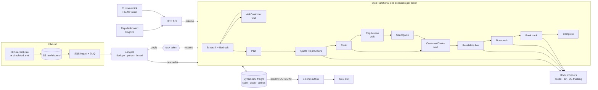
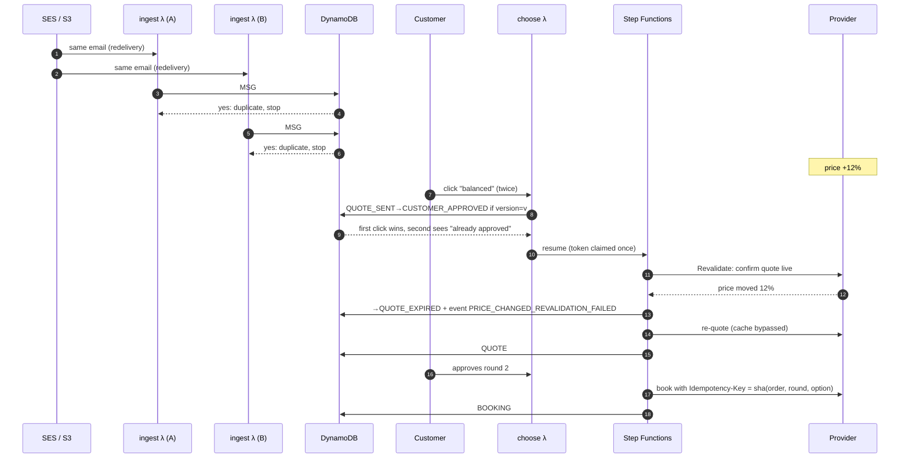

# AI Freight Coordination: architecture and design answers

This document answers the 14 topics and the follow-up question from the exercise
(`System Design Practice AI Freight Coordination.md`), pointing at the code that implements each
answer. [PLAN.md](../PLAN.md) has the original plan; [§9 of the plan](../PLAN.md#9-as-built-notes)
lists where the build differs from it.

The one idea behind every answer: **the LLM reads language; deterministic code decides.** The
model fills in a form. It never sets a price, picks a container, changes an order's state, or
books anything.

## Topic 1: Which AWS services, and what each one does

| Service | Role here | Code |
|---|---|---|
| SES | Outbound email (sandbox). Inbound in production through a receipt rule writing to S3 | [outbox_sender.py](../src/freight/workflow/outbox_sender.py) |
| S3 | The raw `.eml` (the original email, immutable) and extracted attachments | [storage_stack.py](../infra/stacks/storage_stack.py) |
| SQS + DLQ | Buffers S3 events into ingest, retries, isolates poison messages | [handlers/ingest.py](../src/freight/handlers/ingest.py) |
| Lambda (arm64, Python 3.12) | Stateless steps; never the orchestrator | [handlers/](../src/freight/handlers/workflow.py) |
| Step Functions Standard | One durable execution per order: waits of days, retries, catch, audit graph | [graph.py](../src/freight/workflow/graph.py) |
| DynamoDB | Order state + version, audit trail, outbox, quotes, bookings (single table); cache table with TTL; idempotency table | [repo.py](../src/freight/persistence/repo.py) |
| DynamoDB Streams | Triggers email delivery from outbox rows | [workflow_stack.py](../infra/stacks/workflow_stack.py) |
| EventBridge | `PriceChanged` from providers → cache invalidation | [cache_invalidate.py](../src/freight/handlers/cache_invalidate.py) |
| API Gateway (HTTP API) | Rep dashboard API (Cognito JWT), customer choice links, mock providers | [api_stack.py](../infra/stacks/api_stack.py) |
| Cognito | Rep login for the dashboard | [api_stack.py](../infra/stacks/api_stack.py) |
| Bedrock (Claude Haiku 4.5) | Extraction, behind a provider-neutral port | [llm/bedrock.py](../src/freight/extraction/llm/bedrock.py) |
| SSM Parameter Store | Link-signing key (SecureString) and runtime switches (LLM kill switch, email mode, chaos) | [config.py](../src/freight/config.py) |
| CloudWatch + X-Ray | Structured logs (7 days), EMF business metrics, 5 alarms, one dashboard, traces | [observability_stack.py](../infra/stacks/observability_stack.py) |

Deliberately left out, and why: ElastiCache (≥ $12/month idle; DynamoDB TTL + Lambda memory are
enough at this scale), VPC/NAT (~$32/month and nothing here needs a VPC), Secrets Manager (SSM
SecureString is free), customer-managed KMS keys (AWS-managed keys still encrypt at rest), and
CloudFront (the dashboard is served by the API Lambda, which also gives Cognito the HTTPS callback
it requires).

## Topic 2: From SES through Lambda to a saved shipment

1. SES (or `scripts/send_inbound.py`, or the dashboard's *Simulate email*) writes the raw MIME to
   `s3://freight-raw-…/inbound/…`. Simulated and real inbound share the same path, so the code is
   identical.
2. The S3 notification lands in SQS; [handlers/ingest.py](../src/freight/handlers/ingest.py)
   takes batches with partial-failure reporting.
3. The handler computes the email's **dedupe key** (`sha256(Message-ID)`, or of sender + date +
   normalized body when there is no Message-ID) and runs the rest under Powertools idempotency.
4. [email/parse.py](../src/freight/email/parse.py) parses MIME, strips HTML, **cuts quoted
   history** (`On … wrote:`, `Am … schrieb:`, `El … escribió:`, Outlook headers, `>` lines) and
   extracts attachment text (PDF, XLSX, CSV).
5. [email/threading.py](../src/freight/email/threading.py) finds the order (Topic 4 lists the
   rules).
6. [workflow/ingest.py](../src/freight/workflow/ingest.py) writes the email row and an audit event
   in one transaction. A new order also gets its META row and the Message-ID index, and its Step
   Functions execution is started **named after the order id**. A reply to a waiting order
   resumes the waiting step instead.
7. The execution's first step, [extract_step](../src/freight/workflow/steps.py), turns the whole
   thread into a validated `ShipmentRequest` and stores it as `EXTRACTION#n`. That is the "saved
   shipment": every field carries its status, confidence and sources (Topic 6).

## Topic 3: Is Lambda enough?

No. Lambda is right for each short step, but an order waits **days** for the customer and the rep.
Step Functions Standard holds that wait for free (a `.waitForTaskToken` task), retries each step
with backoff, catches failures into an escalation path, and shows every order as a graph in the
console. Express workflows cannot wait that long. SQS sits in front of ingest to absorb bursts and
keep poison messages out of the way, and EventBridge carries side events (price changes) that must
not slow down or fail the main flow.

The state machine is defined once in [graph.py](../src/freight/workflow/graph.py). CDK renders
it to ASL, and the local test runner ([local_sfn.py](../tests/integration/local_sfn.py))
interprets the same definition, so what the end-to-end tests exercise is what gets deployed.

## Topic 4: Data model and state machine

**Single table `freight`** ([keys.py](../src/freight/persistence/keys.py)), one partition per
order so a business step commits in one transaction:

| PK | SK | What |
|---|---|---|
| `ORDER#<id>` | `META` | state, version, customer, language, quote round, waiting task token |
| | `EMAIL#<ts>#<id>` | each email in and out (new text only), S3 pointer, attachments |
| | `EXTRACTION#<n>` | full `ShipmentRequest` snapshot + model, prompt version, cost, changes |
| | `PLAN#<round>` | cargo plan + provider requests |
| | `PQ#<round>#<provider>` | raw provider quotes |
| | `QUOTE#<round>#OPT#<id>` | the options offered, with provider quote id, price, validity |
| | `OUTBOX#<key>` | an email to send, `PENDING → SENDING → SENT` |
| | `BOOKING#main` / `#truck` | provider booking, idempotency key |
| | `EVENT#<ts>#<rand>` | append-only audit: who, what, why, from → to |
| `MSG#<message-id>` | `THREAD` | threading index → order |
| `CUSTOMER#<id>` / `ADDRESS#<email>` | `PROFILE` / `CUSTOMER` | seeded customer profiles |

GSI1 (`customer`, `created`) answers "this sender's open orders" for threading. GSI2
(`state`, `updated`) feeds the dashboard queues.

**Two layers of state machine.** Step Functions decides *what runs next*.
[domain/state.py](../src/freight/domain/state.py) decides *what is allowed*: every transition is
a DynamoDB update conditioned on `state = :expected AND version = :v AND customerId = :c`, written
in the same transaction as its audit event and any outbox row. A stray or duplicate Lambda cannot
move an order along an illegal edge, and a test proves BOOKING is unreachable without
CUSTOMER_APPROVED ([test_state.py](../tests/unit/test_state.py),
[test_graph.py](../tests/unit/test_graph.py)).

**Threading** (requirement: subject changes, no identifier), strongest signal first:
`In-Reply-To`/`References` against every Message-ID we stored or sent → a `FC-XXXXXX` token in
subject or body → the sender's single open order (if the email reads like a reply or that order is
waiting on the customer) → word-overlap similarity with a clear winner → otherwise **ambiguous,
to a human**. It never guesses.

## Topic 5: Pydantic for untrusted LLM output

- The model answers through structured outputs (`messages.parse` with
  [ShipmentLLMOutput](../src/freight/extraction/schema.py)), so the response is schema-valid JSON.
  Every model is `extra="forbid"`.
- That schema is deliberately raw: amounts with their units, dates as ISO strings.
  [normalize.py](../src/freight/extraction/normalize.py) converts units in code (lb → kg, in → cm)
  and validates **each field on its own** against the strict domain model
  [`Extracted[T]`](../src/freight/domain/models.py). An invalid value (zero pallets, a
  country called "Germany") costs only that field, which becomes MISSING and is asked again.
- [provenance.py](../src/freight/extraction/provenance.py) then checks every cited quote really
  appears in the email it names (case- and whitespace-insensitive). Unfound evidence downgrades
  the field to INFERRED with confidence ≤ 0.5. Quotes from our own outbound emails don't count as
  evidence.
- Domain models are frozen, so nothing downstream can mutate a validated value.

## Topic 6: Source and confidence for each field

Every field is an `Extracted[T]`: `value`, `status` (explicit / inferred / missing /
conflicting), `confidence`, `sources[]` (email id + verbatim quote), and `candidates[]` for
conflicts. The model validator forbids inconsistent combinations (a MISSING field with a value, a
CONFLICTING field with fewer than two candidates). Values filled in by code, such as the default
origin brewery, carry the source `system`; rep edits carry `rep:<email>`. The dashboard
highlights each quote inside the original email text.

[merge.py](../src/freight/extraction/merge.py) combines a new extraction with the previous
version field by field. A known value is never forgotten (which is what stops us asking twice). A
different value replaces the old one only if it comes from the latest customer email **and** we
asked about that field (or the old value was only inferred). Otherwise it becomes a conflict, and
conflicts on date, quantity, address or terms are asked back.

## Topic 7: No double processing, no duplicate replies

| Layer | Mechanism |
|---|---|
| Duplicate S3/SQS/SES delivery | Powertools idempotency on the dedupe key; an already-indexed Message-ID returns early; email rows are write-once |
| Two workers creating the order | The order id is derived from the dedupe key, the META put is conditional, and the execution is named after the order (a second start fails) |
| A step retried after it committed | Each transition carries a step key; a retry that finds its own step already applied returns success instead of redoing it |
| Two emails | Transactional outbox: the email is a row written with the state change; the sender claims it `PENDING → SENDING` conditionally; the key is deterministic in (order, purpose, round) |
| Two answers to one wait | Task tokens are claimed with a conditional delete, so only one caller resumes the workflow |

The one remaining gap is documented in
[outbox_sender.py](../src/freight/workflow/outbox_sender.py): if SES accepted an email and the
Lambda died before writing `SENT`, the row stays `SENDING` and is **not** resent, because sending
at most once is safer than sending a duplicate quote. `scripts/report_kpis.py` lists such rows.

## Topic 8: What to cache

| What | Where | Freshness |
|---|---|---|
| Ports, airports, containers, ULDs, products | Lambda memory (`functools.cache`, [catalogs](../src/freight/planning/catalogs/__init__.py)) | Changes only on deploy |
| LLM result for an identical thread | DynamoDB cache, key = sha256(model + prompt version + thread) | 7 days |
| Provider quotes per lane and cargo | DynamoDB cache, grouped by lane | min(quote validity, 10 min) |
| Circuit-breaker state per provider | DynamoDB cache + Lambda memory | 1 hour |

Estimated transit times come back with each provider quote, so they're cached with it.

## Topic 9: Which cache

Combined layers. Lambda memory for static reference data (free, sub-millisecond, rebuilt on each
cold start). The DynamoDB `freight-cache` table with TTL for anything shared between invocations
([providers/cache.py](../src/freight/providers/cache.py)): no servers, pay per request, about
$0 at demo volume. ElastiCache is the production upgrade when reads reach thousands per second and
need sub-millisecond latency, but it costs money every hour it exists.

## Topic 10: Invalidation when price or availability changes

- **TTL** bounds staleness (reads also check the expiry themselves, because DynamoDB deletes
  expired items lazily).
- **Events:** a provider publishes `PriceChanged`; an EventBridge rule runs
  [cache_invalidate](../src/freight/handlers/cache_invalidate.py), which deletes that lane's keys
  through a GSI on the group.
- **A re-quote after a price change bypasses the cache** entirely
  ([quote_step](../src/freight/workflow/steps.py)), so it never depends on the event arriving in
  time.
- Most importantly, **the cache is never used to book.** Revalidation re-confirms the chosen
  quote with the provider live before anything is booked.

## Topic 11: Human in the loop

- [domain/policy.py](../src/freight/domain/policy.py) decides when a rep must see a quote before
  the customer does: value above $25k, reefer, confidence < 0.8 or an inferred critical field, the
  customer's first order, or suspected prompt injection. The reasons are stored and shown to the
  rep.
- The workflow waits on a task token; the rep acts in the
  [dashboard](../src/freight/dashboard/app.js) (Cognito login): approve and send, edit a field
  (a new extraction version with the rep as its source), re-plan, or reject. Orders the system
  cannot handle (unknown address, ambiguous thread, LLM failure, kill switch) go to a NEEDS_HUMAN
  queue with *re-extract*, *re-plan* or *cancel*.
- A re-quote after a price change skips a second review if the request didn't change and prices
  rose less than 15% above what the rep approved.
- **Customer approval is explicit**: each option is a signed, expiring link
  ([links.py](../src/freight/workflow/links.py)). The link opens a confirmation page, and only the
  POST approves, so mail scanners that pre-fetch links can't book anything. The approval is
  recorded as an atomic `QUOTE_SENT → CUSTOMER_APPROVED` transition at the moment of the click
  ([actions.py](../src/freight/workflow/actions.py)). A free-text "yes" in an email is never an
  approval.

## Topic 12: Testing without real bookings or emails

- **Unit** tests for the domain, planning, extraction, email and policy code, with a scripted fake
  LLM.
- **Integration (moto):** conditional transitions, the outbox claim, two workers racing on the
  same order, the cache with TTL.
- **End to end, in process** ([test_order_flow.py](../tests/integration/test_order_flow.py)): the
  real step code, the state machine graph from `graph.py`, the real outbox sender, and the mock
  providers. It covers the demo happy path, the follow-up race, an expired quote, a dead provider,
  the kill switch, prompt injection and a rep rejection.
- **Infrastructure:** `cdk synth` + cdk-nag with zero unresolved findings, and the tables checked
  against the code ([test_infra.py](../tests/integration/test_infra.py)).
- **Extraction quality:** a 16-thread golden set in DE/ES/EN ([golden.jsonl](../tests/eval/golden.jsonl))
  scored by [eval_extraction.py](../scripts/eval_extraction.py) (≥ 90% field accuracy and the
  injection case flagged).
- **In AWS:** only mock providers exist, so nothing real can be booked. SES runs in sandbox mode
  (verified addresses only), with `email-mode=simulator` or `log` as further switches.
  [demo_e2e.py](../scripts/demo_e2e.py) and [chaos_race.py](../scripts/chaos_race.py) drive the
  deployed stack.

[scripts/verify.py](../scripts/verify.py) runs each phase's "done when" check.

## Topic 13: Valid JSON that is wrong for the business

Schema validation proves the JSON is well-formed, not that the order makes sense. Three checks
come after it:
1. **Provenance** (Topic 5): the cited text has to exist.
2. **Business rules** ([domain/rules.py](../src/freight/domain/rules.py)): required fields, the
   delivery date in the future and reachable by the chosen mode, the stated weight within 15% of
   quantity × catalog unit weight, addresses resolving to a known gateway, temperature within
   reefer range, and any conflict on a critical field.
3. **Planning from the catalog, not the model** ([planning/](../src/freight/planning/cargo.py)):
   pallets, weight, container and ULD fit are computed. "18 pallets of bottles" becomes
   16,175 kg on one 40' GP, floor-bound at 51% volume, whatever the model believed.

A violation becomes a targeted question (CLARIFY) or a hand-off to a rep (HUMAN). It never leads
to a quote or a booking.

## Topic 14: Proving "a week" became "hours"

Every state change is a timestamped audit event, so the timeline of each order can be rebuilt.
[report_kpis.py](../scripts/report_kpis.py) reports p50/p90 for received → first quote and
received → booked, split into **system time**, **waiting on the customer** and **waiting on a
rep**, against the 5–7 business-day manual baseline. Only system time is fully under our control;
customer time shows whether the questions were clear.

The CloudWatch `Freight` dashboard tracks `TimeToFirstQuote`, `TimeToBooking`,
`HumanReviewRate`, LLM tokens and cost, `FieldsMissingAtFirstPass`, `ClarificationRounds` and
`RepEdits` (each rep edit is an extraction error found in production). Extraction quality is
gated offline by the golden set before any prompt or model change.

## The follow-up: duplicate SES event + price change + two Lambdas

> A quote for a 40' HC was sent. Minutes later the same SES event arrives again, the provider's
> price changes, and two Lambdas process the same order.

| Risk | Prevented by |
|---|---|
| Two different quotes | One execution per order (named by order id); duplicate emails stop at the Message-ID index; quote rows are write-once per round; the `QUOTING → …` transition is conditional on the version, so a second ranking loses |
| Two emails | The outbox row is written in the same transaction as the state change, with a key deterministic in (order, purpose, round); the sender claims it conditionally |
| Saving a price that is no longer valid | Options store the provider quote id, price and `valid_until`; a click after expiry re-quotes; revalidation re-confirms live before booking and re-quotes if the price moved > 0.5%; a re-quote bypasses the cache |
| Duplicate booking after approval | Only `CUSTOMER_APPROVED → REVALIDATING → BOOKING` reaches booking, every edge is conditional; the provider gets an `Idempotency-Key`; the booking row is write-once; a retry finds it and continues |
| Losing work if a function crashes | Step Functions persists progress per state and retries each step; steps are idempotent by step key; failures are caught to Escalate → NEEDS_HUMAN, never dropped; SQS and stream DLQs keep failed events for redrive |

This is tested twice: in process in
[`test_follow_up_race`](../tests/integration/test_order_flow.py), and live by
[chaos_race.py](../scripts/chaos_race.py).

## Non-functional requirements, briefly

- **Scale (thousands of requests per day):** every component is serverless and pay-per-request;
  the only deliberate caps are reserved concurrency on the Bedrock caller (cost) and SQS
  buffering.
- **Availability and retries:** SQS and stream DLQs, Step Functions retries with jitter, provider
  retries with a circuit breaker, and degradation to fewer options when a provider is down.
- **Audit trail:** `EVENT#` rows for every transition, email and rep action; extraction snapshots
  are versioned; the raw email stays in S3.
- **Encryption:** SSE-S3, DynamoDB default encryption, TLS-only bucket and queue policies, a
  SecureString link key.
- **Prompt injection:** emails are delimited and marked as untrusted data, the model has no tools
  and fills a schema only, a regex tripwire runs alongside the model's own flag, and either signal
  sends the order to a rep. Model output can never change state directly.
- **Customer separation:** every item carries `customerId`, transitions are conditioned on it,
  and a known customer quoting another customer's reference token gets a new order instead. The
  production upgrade is IAM `dynamodb:LeadingKeys` with per-tenant key prefixes.
- **Monitoring:** EMF metrics, 5 alarms, a dashboard, X-Ray traces, and JSON logs with emails,
  IBANs and phone numbers redacted.
- **Swapping the LLM provider:** one adapter on the [LLM port](../src/freight/extraction/llm/port.py)
  (Bedrock and the first-party API are both there).
- **Cost:** under $50 by design (PLAN.md §5). The LLM kill switch (`llm-enabled=false`) sends new
  orders to reps without calling Bedrock.
